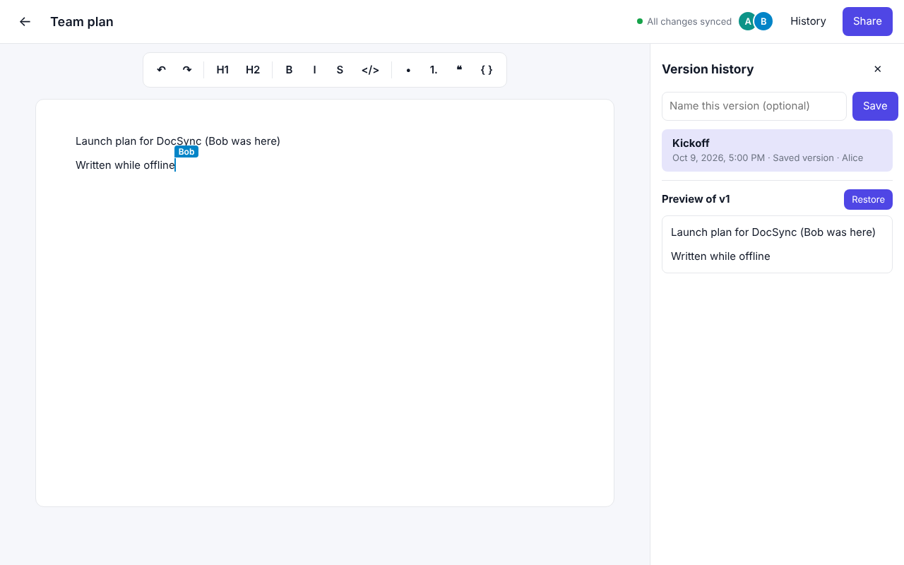

# DocSync

A CRDT-based collaborative document editor. Several people edit the same document at once, online or
offline, and every replica converges to the same content with no central lock and no lost work.



## Architecture

```
 ┌──────────── Browser (each user) ────────────┐
 │  React + TipTap editor                       │
 │        │ y-prosemirror binding               │
 │  Y.Doc  (local CRDT replica)                 │
 │   ├─ y-indexeddb ── IndexedDB (offline copy) │
 │   └─ y-websocket ─┐  doc updates + Awareness │
 └───────────────────┼──────────────────────────┘
          REST (JWT) │ WebSocket (JWT)
   ┌─────────────────┘        │
   ▼                          ▼
 ┌───────────────┐   internal  ┌──────────────────────────┐
 │  Backend API  │ ──────────► │      Sync server         │
 │  Express      │  snapshot,  │  one Room per document:  │
 │  auth, docs,  │  restore,   │  Y.Doc + Awareness,      │
 │  permissions, │  revalidate │  merges & relays updates │
 │  versions     │             │  persists + snapshots    │
 └───────┬───────┘             └────────┬─────────┬───────┘
         │                              │         │
         ▼                              ▼         ▼
 ┌────────────────────────────────────────┐  ┌──────────────────┐
 │ PostgreSQL                             │  │ Object store     │
 │ users, documents (+ latest Yjs state), │  │ (MinIO / S3)     │
 │ document_permissions, snapshot index   │  │ version snapshots│
 └────────────────────────────────────────┘  └──────────────────┘
```

| Package | What it does |
| --- | --- |
| `packages/web` | React + TipTap editor. Each open document is a local `Y.Doc` persisted to IndexedDB, so it opens and edits with no network. Live cursors and presence come from Yjs Awareness. A small service worker caches the app shell so the app itself loads offline. |
| `packages/sync` | WebSocket server speaking the standard y-websocket protocol. Holds one in-memory room per open document, merges every client update into it, relays it to everyone else, and relays Awareness. Persists the merged state to Postgres (debounced) and writes periodic snapshots to the object store. |
| `packages/api` | Express REST API: register/login (bcrypt + JWT), document CRUD, sharing with `owner` / `editor` / `viewer` roles, and version history (list, preview, save, restore). |
| `packages/common` | Config, Postgres pool and migrations, JWT helpers, permission checks, snapshot store (S3 or local folder). |
| `db/migrations` | SQL schema. Applied automatically on start. |

### How the main guarantees are met

- **Conflict-free merging.** Content is a Yjs `XmlFragment`. Every edit is a CRDT update that commutes with every other, so the server just applies updates in whatever order they arrive. No locks, no operational transform, no "someone else is editing" errors.
- **Offline editing.** Edits always go into the local `Y.Doc` first and are saved to IndexedDB. When the socket reconnects, the sync handshake (state vector exchange) sends each side exactly what it's missing and the replicas converge.
- **Live cursors and presence.** Yjs Awareness carries each user's cursor and identity. The server overwrites the `user` field in every Awareness update with the identity from that connection's JWT, so nobody can show up as someone else.
- **Permissions are enforced on the socket too.** The sync server checks the role when a socket connects. Viewers can load the document but their writes are dropped. Changing or revoking someone's access updates or closes their live connection immediately.
- **Durability.** The merged state is written to `documents.ydoc_state` at most `PERSIST_DEBOUNCE_MS` after the last edit (and never more than `PERSIST_MAX_WAIT_MS` later). Open rooms are flushed on shutdown.
- **Version history.** While a document changes, the sync server writes a full snapshot to the object store every `SNAPSHOT_INTERVAL_MS`, when the last person leaves, and when someone saves a named version. Postgres keeps the index (`document_snapshots`). Restoring a version applies the old content as a *new* change, so it reaches everyone live and nothing is rewound. The current state is snapshotted first, so a restore can itself be undone.

## Running it

### With Docker

```bash
docker compose up --build
```

Then open http://localhost:8080, create an account, and open the same document in a second browser (or a private window with another account you've shared it with). The MinIO console is at http://localhost:9001 (minioadmin / minioadmin).

Set `JWT_SECRET` and `INTERNAL_SECRET` in the environment for anything beyond local use.

### For development

Requires Node 20+ and a Postgres 14+ database.

```bash
npm install
cp .env.example .env            # then adjust; or export the variables
docker compose up -d postgres minio   # or point DATABASE_URL at your own Postgres
set -a; source .env; set +a
npm run dev                      # api :4000, sync :4001, web :5173 (Vite proxies /api and /sync)
```

No MinIO handy? Set `STORAGE_DRIVER=fs` and snapshots go to `FS_STORAGE_DIR` on disk.

### Tests

With the API and sync server running:

```bash
npm run test:e2e -w @docsync/sync
```

This drives real Yjs clients through the same `y-websocket` provider the browser uses and checks: live sync, Awareness identity, offline edits merging after reconnect, viewer writes being rejected, non-members being refused, snapshot/preview/restore, revoking access mid-session, and reload from Postgres after a room closes.

`npm run typecheck` typechecks all packages.

## API

All routes except `/auth/register` and `/auth/login` take `Authorization: Bearer <token>`.

| Method | Path | Role | |
| --- | --- | --- | --- |
| POST | `/auth/register` | | `{ email, name, password }` → `{ token, user }` |
| POST | `/auth/login` | | `{ email, password }` → `{ token, user }` |
| GET | `/auth/me` | | Current user |
| GET | `/documents` | | Documents you can access, with your role |
| POST | `/documents` | | `{ title? }` creates a document you own |
| GET | `/documents/:id` | viewer | Metadata |
| PATCH | `/documents/:id` | editor | `{ title }` |
| DELETE | `/documents/:id` | owner | Deletes the document and its snapshots |
| GET | `/documents/:id/permissions` | viewer | Who has access |
| PUT | `/documents/:id/permissions` | owner | `{ email, role: "editor" \| "viewer" }` adds or changes access |
| DELETE | `/documents/:id/permissions/:userId` | owner | Removes access |
| GET | `/documents/:id/versions` | viewer | Version list |
| POST | `/documents/:id/versions` | editor | `{ label? }` saves a named version now |
| GET | `/documents/:id/versions/:v/content` | viewer | Raw Yjs state of a version (for preview) |
| POST | `/documents/:id/versions/:v/restore` | editor | Restores a version for everyone |

Non-members get `404` for a document rather than `403`, so document ids can't be probed.

**WebSocket:** `ws://<host>/sync/<documentId>?token=<jwt>` speaks the standard y-websocket protocol. Close codes `4401` (bad token), `4403` (no access or access revoked) and `4404` (document deleted) tell the client to stop reconnecting.

## Production notes

- The sync server keeps each document's room in one process. To run several instances, route by document id (sticky hashing at the load balancer), or add a Redis pub/sub relay between instances.
- Add rate limiting on `/auth/*` and serve everything over HTTPS/WSS.
- Snapshots are full document states. For very large or very busy documents, consider pruning old auto-snapshots or keeping only every Nth one after a while.
